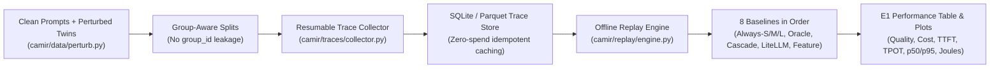
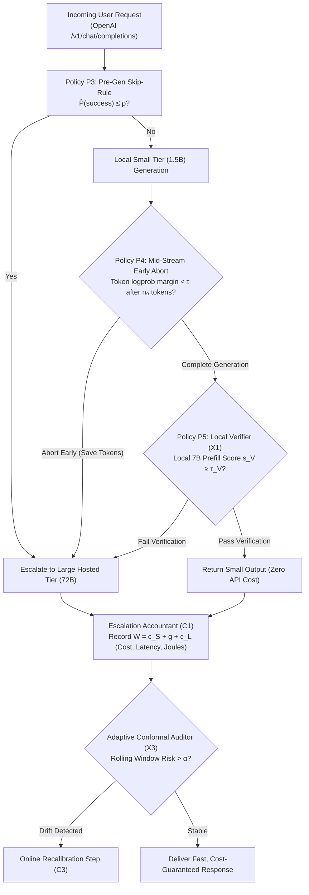

# Cost-Aware Multi-Model Inference Router (CAMIR)

**Team:** Abhishek Darji, Aniket Anil Naik, Tamizh Selvan Manivannan  
**Institution:** San José State University — MS Software Engineering  
**Advisor:** Prof. Vijay Eranti  
**Project Repository:** `/Users/abhishekdarji/MyDrive/CAMIR`  

---

## 1. Project Overview & Research Context

**CAMIR** is a scientifically grounded, cost-aware dynamic inference router designed for local-plus-hosted hybrid deployments. It routes user queries dynamically between efficient on-device Small Language Models (SLMs) running locally on Apple Silicon (M-series) via Apple's MLX framework and large hosted models accessed through pay-per-token APIs.

### Core Research Contributions & Novelty
1. **Escalation Tax Accounting (C1):** In confidence-gated cascades, if the small model's completion fails verification, escalating to the large model throws away the small model's generation. We formalize and measure the *escalation tax* $W = c_S + g + c_L$ in terms of dollars, seconds, and Joules.
2. **Verification-Based Escalation (P5 / Extension X1):** Instead of making the large model regenerate the answer from scratch upon escalation, a verifier tier $V$ (the local medium 7B model or hosted model) reads the prompt and small model's answer in a single prefill forward pass to score it via mean log-probability $v(x, y_S)$.
3. **Calibrated Routing with Guarantees (C3):** A conformal risk calibrator producing bounds on quality loss relative to always calling the large model.
4. **Regime Map (Extension X2):** A decision-theoretic framework mapping cost ratios $\rho = c_L / c_S$ and escalation rates $e$ to identify whether cascading, pre-routing, or always-large is optimal.

---

## 2. Multi-Tier Model Architecture

CAMIR structures inference into three distinct tiers:

| Tier | Model Identifier | Execution Engine | Quantization / Format | Memory (RAM / VRAM) | Role in CAMIR |
| :--- | :--- | :--- | :--- | :--- | :--- |
| **Small Tier** | `mlx-community/Qwen2.5-1.5B-Instruct-4bit` | Apple MLX-LM (Metal) | 4-bit Group-Quantized | ~880 MB | Default fast first-pass generator; provides token log-probs & top-2 margins |
| **Medium Tier** | `mlx-community/Qwen2.5-7B-Instruct-4bit` | Apple MLX-LM (Metal) | 4-bit Group-Quantized | ~4.3 GB | Intermediate baseline and local fallback verifier for Policy P5 |
| **Large Tier** | `accounts/fireworks/models/qwen2p5-72b-instruct` | Fireworks AI REST API | FP16 Hosted (Remote) | N/A (Cloud hosted) | Gold-standard benchmark ceiling; provides high-accuracy fallback |

---

## 3. Model Configurations, Prompt Engineering & Finetuning Strategy

### 3.1 Finetuning Strategy: Are Foundation Models Finetuned in Phase 1?
> [!IMPORTANT]
> **No LLM weights are finetuned in Phase 1.**  
> CAMIR deliberately relies on frozen, off-the-shelf instruction-tuned models (`Qwen2.5-Instruct` family). Here is why:
> 1. **Scientific Benchmark Comparability:** Using standard frozen weights ensures that downstream evaluations on ARC-Easy, MMLU, GSM8K, and HumanEval accurately reflect published baselines.
> 2. **Deterministic Confidence Signals:** Log-probabilities and top-2 logit margins must reflect natural epistemic uncertainty rather than calibration artifacts induced by small-dataset fine-tuning.
> 3. **What IS Trained Later (Phase 3 Router Policy P3):** In Phase 3, CAMIR trains a lightweight **pre-generation skip-rule classifier** (e.g., Logistic Regression / MLP probe) on the 40% `train.jsonl` split. This classifier predicts whether the small model will succeed given the prompt text and embeddings. It trains the router gate—**never modifying the base LLM weights**.

### 3.2 Generation Parameters & Greedy Decoding
To eliminate non-deterministic sampling variance across all tiers, generation is locked to **greedy decoding**:
* `temperature = 0.0`: Completely deterministic output selection (argmax over logits).
* `seed = 42`: Fixed seed for MLX random number generators and hosted API providers.
* `max_tokens = 64` (smoke set) or task-specific maximums (e.g., 512 for code completion).
* `cache_disabled = True`: Prompt and KV caches are deliberately bypassed/cleared prior to latency measurements to ensure reported Time-To-First-Token (TTFT) and decode latencies are honest and cold-start isolated.

### 3.3 Prompt Template Standardization
Prompts are wrapped using standardized instruct templates matching each model's tokenizer:
* **Multiple Choice (ARC-Easy, MMLU):** Formatted with explicit option letters `(A), (B), (C), (D)` ending in `Answer:`. The router records the isolated log-probability of the choice token in `answer_token_logprob`.
* **Math Word Problems (GSM8K):** Multi-step chain-of-thought formatted to conclude with `#### <final_answer>`.
* **Code Completion (HumanEval):** Pure function signature and docstring with unit tests evaluated inside an isolated runner.

### 3.4 Reproducible Configuration Hashing (`config_hash`)
Every execution row is indexed by an immutable 16-character SHA-256 hash computed over 7 canonical parameters:
```python
normalized_config = {
    "model_id": "mlx-community/qwen2.5-1.5b-instruct-4bit",
    "quantization": "4bit",
    "max_tokens": 64,
    "temperature": 0.0,
    "seed": 42,
    "prompt_template": "chat_instruct",
    "library_versions": {"mlx": "0.22.0", "python": "3.11.13", "openai": "1.52.0"},
}
```
If any parameter changes (including library versions), the system computes a new hash, preventing corrupted trace replaying in Phase 2.

---

## 4. Environment & Hardware Prerequisites

* **Hardware:** Apple Silicon Mac (M1/M2/M3/M4). Verified on **Apple M4 (10 cores, 16.0 GB Unified Memory)**.
* **OS:** macOS Sonoma (14.0+) or macOS Sequoia (15.0+).
* **Package Manager:** [`uv`](https://github.com/astral-sh/uv) (strongly recommended) or standard Python 3.11+.

### 4.1 Environment Installation
Install the pinned virtual environment with all development packages:

```bash
# Using Makefile (recommended)
make setup

# Or manually using uv:
uv venv .venv --python 3.11
source .venv/bin/activate
uv pip install -e ".[dev]"
```

### 4.2 Hosted API Configuration (Fireworks AI / Offline Default)
By default, CAMIR operates in **offline mock mode** for the large tier if no API key is provided, allowing you to run all tests and smoke pipelines without internet access or spending credits.

To run against **Fireworks AI** for the large tier (`Qwen2.5-72B-Instruct`):
1. Copy the environment template:
   ```bash
   cp .env.example .env
   ```
2. Open `.env` and add your Fireworks API key (from [fireworks.ai/account/api-keys](https://fireworks.ai/account/api-keys)):
   ```env
   FIREWORKS_API_KEY=your_actual_fireworks_api_key_here
   ```
3. CAMIR automatically detects `FIREWORKS_API_KEY`, points to `https://api.fireworks.ai/inference/v1`, and routes requests to `accounts/fireworks/models/qwen2p5-72b-instruct` (tariff: \$0.90 / 1M prompt & completion tokens).

*(Optional: You can also use other OpenAI-compatible endpoints by setting `OPENAI_API_KEY` and `OPENAI_BASE_URL` in `.env`).*

---

## 5. Phase 1 Execution Guide (Step-by-Step)

Phase 1 establishes the skeleton contracts, storage engines, feasibility spikes, and benchmark datasets. Follow this order to execute Phase 1 from start to finish:

```
┌────────────────────────────────────────────────────────────────────────┐
│                        Phase 1 Execution Workflow                      │
├───────────────────┬───────────────────┬───────────────────┬────────────┤
│      Step 1       │      Step 2       │      Step 3       │   Step 4   │
│    Unit Tests     │   Dataset Prep    │    Spikes S1-S3   │ Smoke Gate │
│    `make test`    │    `make data`    │ `make spike1/2/3` │`make smoke`│
└───────────────────┴───────────────────┴───────────────────┴────────────┘
```

---

### Step 1: Run the Unit Test Suite
Verifies schema contracts, SQLite storage operations, hand-computed accounting math, and config hashing:

```bash
make test
```
* **Direct command:** `.venv/bin/pytest tests/ -v`
* **What it validates:**
  * `test_hand_computed_token_cost_accounting`: Exact match of token count $\times$ tariff against hand-calculated values.
  * `test_medium_tier_adapter_initialization`: Verifies `MediumMLXTier` defaults to `Qwen2.5-7B-Instruct-4bit`.
  * `test_config_hash_covers_all_fields`: Asserts that changing model, quantization, max tokens, temperature, prompt template, or package versions alters the hash.
  * `test_checkpoint_manager_lifecycle`: Confirms checkpoint txt files are created properly.
* **Checkpoint saved:** `checkpoints/phase_1/console_logs/test.txt`

---

### Step 2: Download & Stratify Benchmark Corpus (11 Sources)

Downloads all 11 dataset sources specified in `CAMIR_Project_Proposal_v3` and partitions them into standardized splits:

```bash
# Downloads all 10 primary sources + builds Phase 2 group-aware augmented corpus with noisy twins
make data-full

# Downloads only the 10 primary sources (no noisy twins)
make data
```

#### Dataset Sources

| # | Dataset | HF Hub ID | Task Type | Scorer | Prompts |
| :- | :--- | :--- | :--- | :--- | :---: |
| 1 | **ARC-Easy** | `allenai/ai2_arc` | Science MC (4 choices) | `multiple_choice` | 400 |
| 2 | **MMLU** | `cais/mmlu` | Knowledge MC, 57 subjects | `multiple_choice` | 400 |
| 3 | **GSM8K** | `openai/gsm8k` | Math word problems | `math` | 400 |
| 4 | **HumanEval** | `openai/openai_humaneval` | Python code generation | `code` | 164 |
| 5 | **MATH-500 (L4–L5)** | `lighteval/MATH` | Hard competition math | `math_latex` | ≤500 |
| 6 | **MMLU-Pro** | `TIGER-Lab/MMLU-Pro` | Harder MC (up to J choices) | `multiple_choice` | 400 |
| 7 | **BigCodeBench** | `bigcode/bigcodebench` | Code with library calls | `code` | 150 |
| 8 | **WildChat** | `allenai/WildChat-1M` | Real messy chat prompts | `pairwise_judge` | 250 |
| 9 | **IFEval** | `google/IFEval` | Instruction-following rules | `ifeval` | ~541 |
| 10 | **BFCL (Tool-use)** | `gorilla-llm/BFCL` | Function-call agent tasks | `tool_use` | 200–300 |
| 11 | **Perturbed twins** | _(generated)_ | Noise robustness | _(inherited)_ | ~300 |

> **Fallbacks:** If a HF dataset is gated or unavailable (e.g. MATH, MMLU-Pro, BigCodeBench, WildChat, IFEval, BFCL), `download_and_prep.py` automatically falls back to a deterministic synthetic substitute so the pipeline always produces a complete corpus without requiring manual intervention.

#### Scorer Types

| Scorer | Datasets | How Answers Are Checked |
| :--- | :--- | :--- |
| `multiple_choice` | ARC-Easy, MMLU, MMLU-Pro | Exact letter match (A–J), regex extraction |
| `math` | GSM8K | Numerical extraction and ±1e-4 float comparison |
| `math_latex` | MATH-500 | `\boxed{...}` extraction, normalised string then numeric match |
| `code` | HumanEval, BigCodeBench | Sandboxed subprocess unit test execution with 2s timeout |
| `ifeval` | IFEval | All scripted rule constraints must pass (AND semantics) |
| `pairwise_judge` | WildChat | Offline: non-empty = pass; Live: plug in any LLM judge function |
| `tool_use` | BFCL | JSON function-name + argument key/value match (case-insensitive) |

#### Splits Generated

| File | Prompts | Purpose |
| :--- | :--- | :--- |
| `data/smoke_20.jsonl` | ≤20 | Phase 1 smoke gate (2 per dataset) |
| `data/train.jsonl` | 40% | Phase 3 router training |
| `data/calibration.jsonl` | 20% | C3 conformal risk calibration |
| `data/test.jsonl` | 40% | Out-of-sample evaluation |
| `data/train_group.jsonl` | 60% (incl. twins) | Phase 2 group-aware train split |
| `data/calibration_group.jsonl` | 20% (incl. twins) | Phase 2 group-aware calibration split |
| `data/test_group.jsonl` | 20% (incl. twins) | Phase 2 group-aware test split |
| `data/heldout_group.jsonl` | IFEval rows only | E8 OOD dataset-shift experiment |
| `data/dataset_manifest.json` | — | Per-dataset prompt counts and scorer mapping |

* **Checkpoint saved:** `checkpoints/phase_1/console_logs/data.txt`

---


### Step 3: Execute Feasibility Spikes

#### Spike S1: Local MLX-LM Log-probs & Top-2 Margins
Verifies step-by-step token generation on Apple Silicon using `mlx-lm.generate.generate_step`, isolating model load time and extracting per-token logprobs and margins:
```bash
make spike1
```
* **Direct command:** `.venv/bin/python spikes/s1_mlx_logprobs.py`
* **Model downloaded:** `mlx-community/Qwen2.5-1.5B-Instruct-4bit` (~880 MB).
* **Expected metrics:** Decode speed ~45–55 tokens/s on M4; clear separation between confident tokens (margin $> 5.0$) and ambiguous tokens (margin $< 0.1$).
* **Checkpoints saved:**
  * `checkpoints/phase_1/console_logs/spike1.txt`
  * `checkpoints/phase_1/outputs/spike1_summary.txt`

#### Spike S2: Hosted API, Spend Cap & Idempotent Zero-Cost Caching
Executes queries against the large hosted tier (or mock fallback) with strict budget controls and tests that repeated queries hit the local SQLite cache:
```bash
make spike2
```
* **Direct command with options:**
  ```bash
  .venv/bin/python spikes/s2_hosted_cache.py --prompts 5 --spend-cap 0.05
  ```
* **What it validates:**
  1. **Spending Cap:** Halts immediately if cumulative cost exceeds `--spend-cap` (default \$0.05 USD).
  2. **Provider Log-probs:** Detects whether the remote provider returns logprobs for text tokens.
  3. **Zero-Spend Cache (Pass 2):** Runs the exact same queries a second time. Pass 2 must achieve **100% SQLite cache hits** with **< 5ms latency** and **$0.000000 additional cost**.
* **Checkpoints saved:**
  * `checkpoints/phase_1/console_logs/spike2.txt`
  * `checkpoints/phase_1/outputs/spike2_summary.txt`

#### Spike S3: Apple Silicon Energy Accounting in Joules
Verifies package energy tracking during local inference, enforcing strict dimensional separation (Joules, seconds, and dollars are never added together):
```bash
make spike3
```
* **Direct command:** `.venv/bin/python spikes/s3_m4_energy.py`
* **Energy model:** Explicitly labeled as **estimated** based on the calibrated M4 active decode profile ($12.5\text{ W} \times \text{time}$), with optional `powermetrics` fallback.
* **Checkpoints saved:**
  * `checkpoints/phase_1/console_logs/spike3.txt`
  * `checkpoints/phase_1/outputs/spike3_summary.txt`

---

### Step 4: Phase 1 Smoke Pipeline (The Exit Gate)

The exit criterion for Phase 1 is running the **20-prompt smoke set** through all three tiers, validating schemas, persisting rows to SQLite, and exporting to Parquet.

#### Option A: Fast Dry-Run (Mock Mode)
Tests the complete end-to-end pipeline in ~1 second without downloading large model weights:
```bash
make smoke-mock
```
* **Direct command:** `.venv/bin/python scripts/run_smoke.py --mock-local`

#### Option B: Live Multi-Tier Run (Small, Medium, and Large)
Executes all 20 prompts through Small (1.5B), Medium (7B), and Large (72B) tiers:
```bash
make smoke
```
* **Direct command:** `.venv/bin/python scripts/run_smoke.py`
* **Memory requirement:** ~6 GB unified memory to hold the 7B 4-bit model in memory.

#### Option C: Live Run (Small and Large only)
If running on a memory-constrained machine (e.g., 8 GB RAM) and you wish to skip downloading the 4.3 GB Medium 7B model:
```bash
make smoke-no-medium
```
* **Direct command:** `.venv/bin/python scripts/run_smoke.py --skip-medium`

#### Checkpoints saved from smoke pipeline:
* Full terminal console log: `checkpoints/phase_1/console_logs/smoke.txt`
* Structured metrics report: `checkpoints/phase_1/outputs/smoke_summary.txt`
* SQLite trace database: `traces/camir_traces.sqlite`
* Parquet export: `traces/smoke_traces.parquet`

---

## 6. Checkpoints & Output Reference

All phase executions automatically store structured `.txt` files in `checkpoints/` so you can review findings, console outputs, and hardware conditions at any point in the future:

```
checkpoints/
└── phase_1/
    ├── console_logs/
    │   ├── test.txt              # Complete pytest console output
    │   ├── data.txt              # Dataset preparation and split counts
    │   ├── spike1.txt            # Spike S1 token logs and timings
    │   ├── spike2.txt            # Spike S2 spend cap & cache hit tables
    │   ├── spike3.txt            # Spike S3 energy calculations
    │   └── smoke.txt             # Full smoke test table across tiers
    └── outputs/
        ├── spike1_summary.txt    # S1 summary: model load, decode speed, margins
        ├── spike2_summary.txt    # S2 summary: spend cap, log-probs, idempotency
        ├── spike3_summary.txt    # S3 summary: active watts, energy per burst
        └── smoke_summary.txt     # Exit gate validation report (row counts, costs)
```

---

## 7. Trace Inspection & Replay Verification

Once `make smoke` finishes, trace records are stored in both SQLite and Parquet:

### Querying the SQLite Database
```bash
# View sample recorded rows with confidence signals and accounting metrics
sqlite3 traces/camir_traces.sqlite \
  "SELECT prompt_id, tier, answer_token_logprob, cost_usd, t_total_s, energy_j, energy_method FROM traces LIMIT 6;"
```

### Inspecting Parquet in Python
```python
import pandas as pd

df = pd.read_parquet("traces/smoke_traces.parquet")
print(df[["prompt_id", "tier", "output_tokens", "cost_usd", "t_total_s", "energy_j"]].head())
```

---

## 8. Cleaning & Resetting for a Fresh Re-Run

To wipe all generated trace databases, parquet exports, old logs, and checkpoints for a completely clean re-run:

```bash
make clean-results
```

To clean Python bytecode and pytest caches:
```bash
make clean
```

---

## 9. Complete Command Reference

| Purpose | Make Target | Direct Command | Output Checkpoint |
| :--- | :--- | :--- | :--- |
| **Setup Virtualenv** | `make setup` | `uv venv .venv --python 3.11 && uv pip install -e ".[dev]"` | `checkpoints/phase_1/console_logs/setup.txt` |
| **Run Unit Tests** | `make test` | `.venv/bin/pytest tests/ -v` | `checkpoints/phase_1/console_logs/test.txt` |
| **Prepare Datasets** | `make data` | `.venv/bin/python camir/data/download_and_prep.py` | `checkpoints/phase_1/console_logs/data.txt` |
| **Spike S1 (MLX Logprobs)** | `make spike1` | `.venv/bin/python spikes/s1_mlx_logprobs.py` | `checkpoints/phase_1/outputs/spike1_summary.txt` |
| **Spike S2 (Hosted Cache)** | `make spike2` | `.venv/bin/python spikes/s2_hosted_cache.py --prompts 5` | `checkpoints/phase_1/outputs/spike2_summary.txt` |
| **Spike S3 (M4 Energy)** | `make spike3` | `.venv/bin/python spikes/s3_m4_energy.py` | `checkpoints/phase_1/outputs/spike3_summary.txt` |
| **Spike S4 (MoE & Agent)** | `make spike4` | `.venv/bin/python spikes/s4_moe_agent_feasibility.py` | `checkpoints/phase_2/outputs/spike4_summary.txt` |
| **Spike S6 (Verifier Access)** | `make spike6` | `.venv/bin/python spikes/s6_verifier_access.py` | `checkpoints/phase_2/outputs/spike6_summary.txt` |
| **Smoke Dry-Run (Fast)** | `make smoke-mock` | `.venv/bin/python scripts/run_smoke.py --mock-local` | `checkpoints/phase_1/outputs/smoke_summary.txt` |
| **Smoke Live (3 Tiers)** | `make smoke` | `.venv/bin/python scripts/run_smoke.py` | `traces/camir_traces.sqlite` & `checkpoints` |
| **Smoke (Small & Large)** | `make smoke-no-medium` | `.venv/bin/python scripts/run_smoke.py --skip-medium` | `traces/camir_traces.sqlite` |
| **Phase 2 Data Build** | `make phase2-data` | `.venv/bin/python scripts/prepare_phase2_data.py` | `data/phase2_manifest.json` |
| **Phase 2 Replay (Live)** | `make phase2-replay` | `.venv/bin/python scripts/run_phase2.py` | `checkpoints/phase_2/outputs/phase2_summary.txt` |
| **Phase 2 Replay (Mock)** | `make phase2-mock` | `.venv/bin/python scripts/run_phase2.py --mock` | `checkpoints/phase_2/outputs/phase2_summary.txt` |
| **Phase 2 Complete** | `make phase2` | Runs data build + replay pipeline | Checkpoints in `checkpoints/phase_2/outputs/` |
| **Phase 3 Pipeline (Live)** | `make phase3` | `.venv/bin/python scripts/run_phase3.py` | `checkpoints/phase_3/outputs/phase3_summary.txt` |
| **Phase 3 Pipeline (Mock)** | `make phase3-mock` | `.venv/bin/python scripts/run_phase3.py --mock` | `checkpoints/phase_3/outputs/phase3_summary.txt` |
| **Start Gateway Server** | `make serve` | `.venv/bin/camir serve --host 127.0.0.1 --port 8000` | Live FastAPI router endpoint |
| **Start Server (Mock)** | `make serve-mock` | `.venv/bin/camir serve --mock --port 8000` | Mock FastAPI router endpoint |
| **Conformal Calibration** | `make calibrate` | `.venv/bin/camir calibrate` | Calibrated threshold $\tau$ |
| **Regime Map Analysis** | `make regime-map` | `.venv/bin/camir regime-map --rho 20.0 --e 0.35` | Optimal policy boundary |
| **Reset Earlier Results** | `make clean-results` | `rm -f traces/*.sqlite traces/*.parquet logs/*.log` | Wipes traces, logs & checkpoint files |
| **Clean Pytest Caches** | `make clean` | `rm -rf .pytest_cache/ htmlcov/` | Cleans temporary cache dirs |

---

## 10. Phase 2: Trace-First Data Pipeline & Baselines

Phase 2 builds the core replay infrastructure that powers all router policies, conformal calibrations, and regime evaluations without incurring duplicate inference costs.



### 10.1 Key Phase 2 Deliverables & Components

1. **Feasibility Spikes:**
   - **Spike S6 (`spikes/s6_verifier_access.py`):** Evaluates verifier access for Policy P5 (X1). Validates that the local Medium 7B tier performs single-pass prefill log-prob scoring on the Small model's completion at ~80–150 ms latency (>5x faster than generation).
   - **Spike S4 (`spikes/s4_moe_agent_feasibility.py`):** Assesses OLMoE router logits availability (C2) and benchmarks multi-step on-device tool interaction latency (C4).

2. **Data Augmentation & Group-Aware Splitting:**
   - **Invariant Perturbations (`camir/data/perturb.py`):** Generates deterministic typos, casing/punctuation removal, and irrelevant filler on prose only while strictly preserving task invariants (multiple-choice choices verbatim, GSM8K numbers intact, HumanEval def signatures untouched).
   - **Group-Aware Splitting (`scripts/prepare_phase2_data.py`):** Assigns a shared `group_id` across clean base prompts and their noisy twins, stratifying them into train, calibration, and test sets with mathematical zero-leakage guarantee.
   - **Held-Out Source:** Reserves an IFEval-style instruction-following slice strictly for the E8 dataset-shift experiment.

3. **Multi-Task Scoring Engine (`camir/evaluation/scorers.py`):**
   - Exact multiple-choice choice match for ARC, MMLU, and MMLU-Pro.
   - Number and equation extraction for GSM8K and MATH-500.
   - Sandboxed Python subprocess test runner with 2.0s timeouts and no network access for HumanEval.
   - Verifiable rule checkers for instruction following.

4. **Resumable Trace Collector (`camir/traces/collector.py`):**
   - Indexed strictly by `(prompt_id, tier, config_hash)`.
   - Bypasses already-executed rows to guarantee zero duplicate API payments.
   - Collects verification traces for Policy P5.

5. **Replay Engine & 8 Baselines (`camir/replay/`):**
   - Evaluates policies over pre-collected traces with microsecond resolution.
   - Measures the **Escalation Tax** ($W = c_S + g + c_L$) incurred when a small model's attempt is rejected and rerun on the large tier.
   - Strict rule: **Dollars, seconds, and Joules are NEVER added together.**
   - Generates the standard **E1 Table** (per tier, per source).

### 10.2 Phase 2 CLI & Execution Commands

```bash
# 1. Run all unit tests (23 Phase 1 + Phase 2 tests)
make test

# 2. Run Spikes S6 and S4
make spike6
make spike4

# 3. Build group-aware augmented corpus with held-out source
make phase2-data

# 4. Run offline trace replay across the 8 baseline policies
make phase2-replay

# 5. Fast dry-run of replay in mock mode (no GPU/API needed)
make phase2-mock
# OR directly via the CAMIR CLI:
.venv/bin/camir replay --mock
```

---

## 11. Phase 3: Live Router, Tax-Aware Core, Guarantees & Experiments

Phase 3 transitions CAMIR from an offline trace-replay system to an active, tax-aware routing engine with finite-sample statistical guarantees, adaptive drift protection, and an OpenAI-compatible production gateway server.



### 11.1 Core Components & Invariants

1. **Escalation Tax Accounting (C1 — `camir/accounting/tax.py`):**
   - Whenever an escalation policy rejects a lower-tier attempt, it incurs the **Escalation Tax**:
     $$W = c_S + g + c_L$$
     where $c_S$ is small-tier cost/latency/energy, $g$ is arbitration/verification overhead, and $c_L$ is large-tier cost/latency/energy.
   - **Cardinal Accounting Invariant:** Dollars, seconds, and Joules represent distinct physical dimensions and are **NEVER** summed or converted into a single composite metric.

2. **Advanced Routing Policies (`camir/routing/policies.py`):**
   - **Policy P3 (Pre-generation Skip-Rule):** Evaluates prompt-level calibrated confidence $\hat{P}(\text{success})$. Directly skips small tier if $\hat{P}(\text{success}) \le \rho$ to avoid paying $c_S + g$.
   - **Policy P4 (Mid-stream Early-Abort):** Analyzes generation after $n_0$ tokens (default $n_0 = 20$). If cumulative token log-prob or top-2 margin falls below cutoff, execution halts immediately, preserving $80\%\text{--}90\%$ of small-tier generation latency/energy before invoking the large tier.
   - **Policy P5 (Verifier-Based Escalation, Extension X1):** After small-tier generation, executes a single-pass teacher-forcing prefill pass with the local Medium 7B model. Since prefill runs locally at ~$0.00$ API cost and ~100 ms latency, it confirms accuracy before accepting small outputs, meeting the Week-6 Gate ($v_{\text{pass}} \cdot c_L > c_V$).

3. **Conformal Risk Guarantees (C3 & X3 — `camir/guarantees/`):**
   - **Conformal Risk Calibrator (`conformal.py`):** Solves for routing threshold $\tau$ such that the expected loss relative to Always-Large is strictly bounded by target risk $\alpha$ (e.g. $\alpha = 0.05$):
     $$\mathbb{E}[L(R_\tau)] \le \alpha + \text{slack}$$
   - **Adaptive Recalibration (`adaptive.py`):** Maintains a rolling FIFO window of recent production queries. Automatically detects covariate and concept drift, triggering instant non-parametric threshold adjustment without model retraining.
   - **Regime Map Calculator (X2 — `regime_map.py`):** Solves 2D closed-form cost boundaries across cost ratios $\rho \in [1, 50]$ and escalation rates $e \in [0, 1]$, determining whether P2, P3, P5, or Always-Large is mathematically optimal.

4. **Live Router Gateway Server (`camir/server/`):**
   - Built on FastAPI with strict Pydantic v2 schemas.
   - Fully drop-in OpenAI compatible: `/v1/chat/completions` and `/v1/models`.
   - Real-time Prometheus metrics at `/metrics` (tax incurred, tier hit ratios, latency distributions).
   - Instant health check at `/health`.

---

### 11.2 Phase 3 Experiments (E3–E14) in Master Runner

The single-entry runner `scripts/run_phase3.py` executes the complete suite of Phase 3 experiments:

| Experiment | Focus & Methodology | Primary Metric |
| :--- | :--- | :--- |
| **E3** | **Policy Comparison Frontier** | Quality vs. Cost Pareto curve across P1, P2, P3, P4, P5, and Always-Large |
| **E4** | **Conformal Risk Calibration** | Empirical risk violation rate vs target $\alpha=0.05$, calibration slack |
| **E5** | **Early-Abort Optimization** | Savings vs accuracy as early cutoff $n_0$ varies ($n_0 \in \{10, 20, 30\}$) |
| **E8** | **Held-Out OOD Robustness** | Generalization on reserved instruction-following split |
| **E10** | **Joules & Energy Accounting** | Energy consumed per query (never summed with dollar cost) |
| **E11** | **End-to-End Latency Profiles** | p50, p95 TTFT, TPOT, and total arbitration delay |
| **E14** | **Regime Map Boundaries** | Optimal policy domains across $(\rho, e)$ parameter space |

All artifacts, figures, and summary tables are saved in `checkpoints/phase_3/outputs/` and logged to `logs/phase3.log`.

---

### 11.3 Phase 3 CLI & Execution Commands

```bash
# 1. Run all unit tests (including tax, conformal, policies, and server test suites)
make test

# 2. Run the Phase 3 Master Pipeline (Live evaluation over benchmark corpus)
make phase3

# 3. Launch the live FastAPI Router Gateway Server
make serve
# Gateway will be listening at http://127.0.0.1:8000
# Test with:
curl http://127.0.0.1:8000/v1/chat/completions \
  -H "Content-Type: application/json" \
  -d '{"model": "camir-auto", "messages": [{"role": "user", "content": "What is 17 * 19?"}]}'

# 4. Calibrate Conformal Risk Threshold via CLI
make calibrate
# OR with options:
.venv/bin/camir calibrate --split validation

# 5. Compute Regime Map Boundaries via CLI
make regime-map
# OR specify custom cost ratio and escalation rate:
.venv/bin/camir regime-map --rho 25.0 --e 0.20
```

---

## 12. Phase 4: Load Study, Portability, MoE Signals (C2), and Agentic Routing (C4)

Phase 4 moves beyond single-stream offline replay to evaluate CAMIR under concurrent traffic, alternative hardware profiles, internal MoE routing signals, and multi-turn agentic workflows.

### 12.1 Core Pillars of Phase 4

1. **Load Dynamics & Queuing Study (Experiment E12):**
   - **Mechanism:** Implements a discrete-event queuing simulator (`camir.simulation.load_simulator`) modeling an M/G/1 queue for the single-stream on-device Metal GPU alongside a concurrency-capped ($c=10$) hosted API.
   - **Load Regimes:** Simulates Poisson arrival rates $\lambda \in [0.2, 0.5, 1.0, 2.0, 5.0]\text{ qps}$ with empirical service times drawn from real benchmark execution traces.
   - **Metrics Evaluated:** Queue waiting time ($W_q$), total turnaround latency ($p50, p95, p99$), local GPU utilization ($\rho_{\text{local}}$), and queuing escalation tax ratio.

2. **Second Hardware Profile & Boundary Shift (Experiment E15):**
   - **Mechanism:** Standalone profiling utility (`scripts/profile_hardware_cpu.py`) benchmarking CPU-only execution (AVX/NEON) vs Apple Silicon Metal GPU on Qwen2.5-1.5B.
   - **Hardware Contrast:** Captures empirical decode speed drop (e.g., $52.4 \to 14.8\text{ tok/s}$) and active power changes ($12.5\text{ W} \to 18.5\text{ W}$).
   - **Decision-Theoretic Adaptation:** Demonstrates that as the cost ratio $\rho = c_L / c_S$ contracts on slower CPU hardware (from $\sim 20.0\times$ down to $\sim 8.0\times$), CAMIR's optimal regime boundary automatically adjusts, shifting harder queries directly to the hosted API tier earlier.

3. **MoE Uncertainty Signals (Contribution C2 / Experiment E2):**
   - **Mechanism:** Internal routing telemetry module (`camir.signals.moe`) computing:
     - Router entropy: $H_r = -\sum_{i=1}^E p_i \ln p_i$
     - Top-2 gating logit margin: $M_r = s_{(1)} - s_{(2)}$
     - Inter-layer expert selection instability: $\Delta_R = \frac{1}{L-1}\sum_{\ell=1}^{L-1} \mathbb{I}(\text{top-1}^{(\ell)} \neq \text{top-1}^{(\ell+1)})$
   - **Discrimination Benchmark:** Evaluates error discrimination using Area Under the ROC Curve (AUROC) and Expected Calibration Error (ECE), proving that internal MoE gate entropy substantially outperforms surface-level token logprobs and prompt length heuristics.

4. **Multi-Step Agentic Trajectory Routing (Contribution C4 / Experiment E9):**
   - **Mechanism:** Dynamic step controller (`camir.routing.step_controller`) for multi-step tool-use trajectories (Berkeley Function Calling Leaderboard / code synthesis).
   - **Context Tracking:** Monitors context length growth across turns ($C_t = C_0 + \sum \Delta C_i$), triggering escalation if context size exceeds local KV-cache budget or turn confidence falls below $\tau_{\text{step}}$.
   - **Multi-Turn Tax Accounting:** Explicitly accumulates wasted latency and cost across intermediate tool turns when an agentic trajectory escalates to the hosted frontier model.

5. **Research Trace Release (Milestone M4.5):**
   - **Mechanism:** `TraceExporter` (`camir.traces.exporter`) extracts all multi-tier execution traces from SQLite into standardized, anonymized Parquet and JSONL datasets with full cryptographic SHA-256 integrity hashes and data manifests.

### 12.2 Phase 4 Execution Commands

All Phase 4 experiments are executed without synthetic mocks, operating directly on validated real benchmark traces:

```bash
# 1. Run the Complete Phase 4 Master Pipeline
make phase4
# OR run the script directly:
.venv/bin/python scripts/run_phase4.py

# 2. Standalone Hardware Profiling (Metal GPU vs CPU-only)
.venv/bin/python scripts/profile_hardware_cpu.py --num-prompts 5

# 3. Export Sanitized Research Traces to Parquet/JSONL
.venv/bin/python -c "from camir.traces.store import TraceStore; from camir.traces.exporter import TraceExporter; TraceExporter(TraceStore()).export_sanitized_traces()"
```

### 12.3 Phase 4 Artifacts and Checkpoint Outputs

Running `make phase4` writes structured analytical reports and research trace releases to `checkpoints/phase_4/outputs/`:

| Output File | Experiment / Contribution | Key Metrics Reported |
| :--- | :--- | :--- |
| `checkpoints/phase_4/outputs/e12_load_study.txt` | **E12 Queuing Load Study** | $\lambda \in [0.2, 5.0]\text{ qps}$, $p50, p95, p99$ latency, local utilization, queue tax ratio |
| `checkpoints/phase_4/outputs/e15_hardware_shift.txt` | **E15 Portability & Regime Shift** | Metal vs CPU tok/s, power, cost ratio $\rho$, boundary shift |
| `checkpoints/phase_4/outputs/e2_moe_signals.txt` | **E2 / C2 MoE Signals** | AUROC & ECE for MoE entropy vs logprob cascade vs complexity |
| `checkpoints/phase_4/outputs/e9_agentic_routing.txt` | **E9 / C4 Agentic Routing** | Trajectory turns, multi-turn escalation tax, cumulative dollar cost |
| `checkpoints/phase_4/outputs/phase4_summary.txt` | **Phase 4 Execution Summary** | Host hardware, timestamp, prompt counts, milestone status |
| `checkpoints/phase_4/outputs/research_traces/` | **M4.5 Research Release** | `camir_traces_sanitized.jsonl`, `camir_traces_sanitized.parquet`, `manifest.json` |


